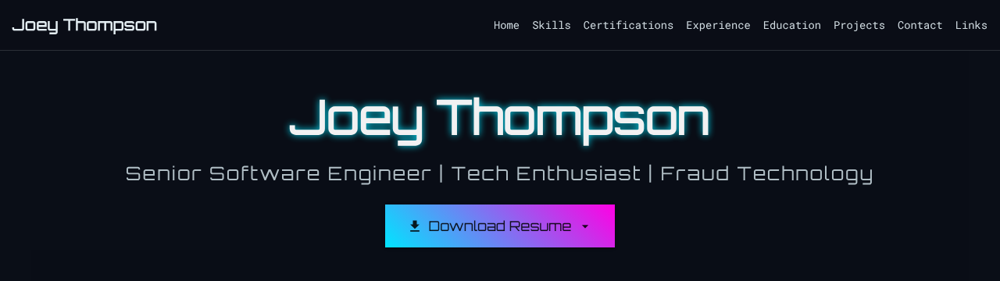
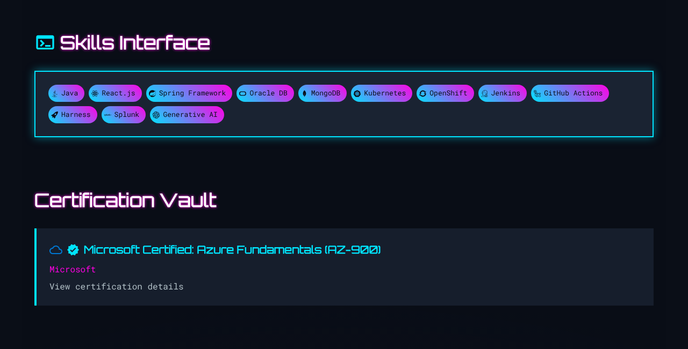
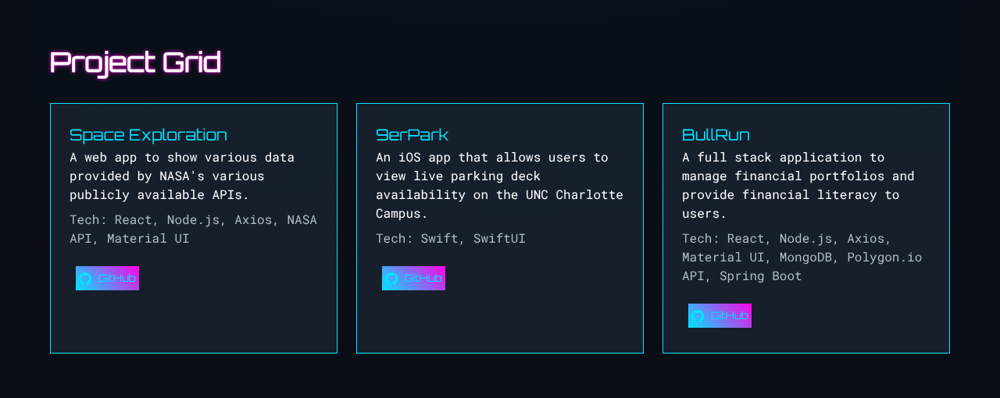
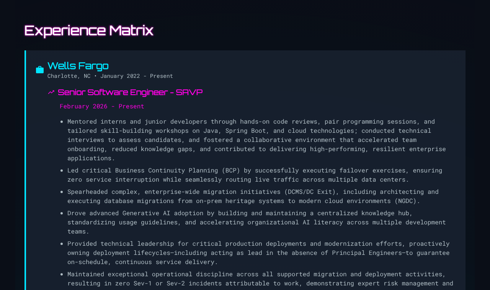
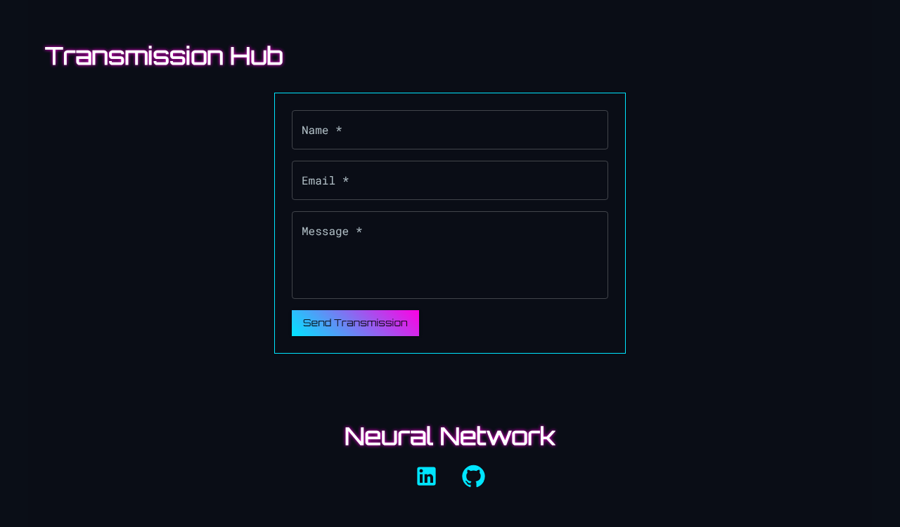
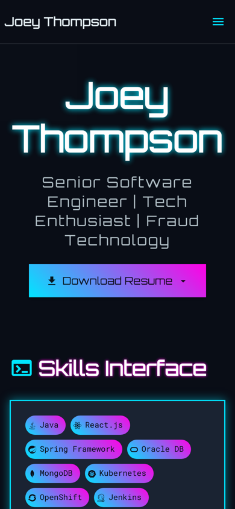
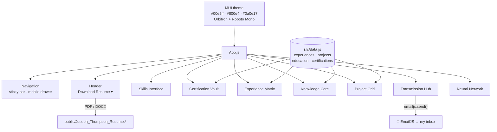

<p align="center">
  
</p>

<p align="center">
  <a href="https://josephlthompson.com"></a>
  
  
  
  
  
</p>

# Cyber Portfolio

My resume, reimagined as a cyberpunk terminal. Neon cyan and magenta on a deep-space background, Orbitron headings that flicker like a failing sign, and glowing cards that lift on hover. It covers my skills, certifications, experience, education and projects. You can download the resume as PDF or Word, or send me a message straight from the page.

**Live site:** https://josephlthompson.com

<p align="center">
  
</p>

## Sections

<p align="center">
  
</p>

- **Header.** My name in flickering neon, my title, and a **Download Resume** menu offering the PDF or the Word document.
- **Skills Interface.** Gradient chips with brand icons for Java, React.js, Spring, Oracle DB, MongoDB, Kubernetes, OpenShift, Jenkins, GitHub Actions, Harness, Splunk and Generative AI. Each chip has a tooltip and links to that technology's docs.
- **Certification Vault.** Certifications with a link to each credential. Currently Microsoft Certified: Azure Fundamentals (AZ-900).
- **Experience Matrix.** Every role, grouped by company, with dates and highlights: Wells Fargo (Senior Software Engineer, Software Engineer, Technology Analyst) and Greenway Chemical Systems & Services (IT Systems Administrator).
- **Knowledge Core.** B.A. in Computer Science from UNC Charlotte, including the 9erPark capstone.
- **Project Grid.** Glowing cards for Space Exploration, 9erPark and BullRun, each with its tech stack and a GitHub link.
- **Transmission Hub.** A contact form that emails me directly through EmailJS. No backend needed.
- **Neural Network.** LinkedIn and GitHub.

A sticky navigation bar jumps to any section. On phones it collapses into a slide-out drawer.

## Screenshots

<table>
  <tr>
    <td width="50%"></td>
    <td width="50%"></td>
  </tr>
  <tr>
    <td align="center"><b>Skills Interface</b> and <b>Certification Vault</b></td>
    <td align="center"><b>Project Grid</b></td>
  </tr>
  <tr>
    <td width="50%"></td>
    <td width="50%"></td>
  </tr>
  <tr>
    <td align="center"><b>Experience Matrix</b></td>
    <td align="center"><b>Transmission Hub</b> and <b>Neural Network</b></td>
  </tr>
</table>

<p align="center">
  
  <br><sub>On a phone.</sub>
</p>

## How it's built

One page. `App.js` sets up a dark MUI theme and stacks the sections, each with an anchor the navigation scrolls to. All the resume content (roles, projects, education, certifications) lives in `src/data.js`, so updating the resume means editing one file.



### The look

| Token | Value | Used for |
| --- | --- | --- |
| Primary | `#00e5ff` neon cyan | Card borders and glow, links, icons |
| Secondary | `#ff00e4` neon magenta | Section headings, accents |
| Background | `#0a0e17` / paper `#1a2332` | Page and cards |
| Headings | Orbitron | Name, section titles |
| Body | Roboto Mono | Everything you read |

Buttons use a cyan-to-magenta gradient that reverses on hover. The background pulses, and the name flickers (`pulse` and `flicker` keyframes in `src/index.css`).

## Getting started

```bash
git clone https://github.com/jlthompson96/Resume_Website.git
cd Resume_Website
npm install
npm start
```

Open http://localhost:3000.

To change the content, edit `src/data.js`. To swap the downloadable resume, replace `public/Joseph_Thompson_Resume.pdf` and `.docx`. The contact form's EmailJS service, template and public key are in `src/components/Contact.js`.

## Scripts

| Command | Description |
| --- | --- |
| `npm start` | Start the dev server on port 3000 |
| `npm run build` | Build for production into `build/` |
| `npm test` | Run tests with Jest |

## Project structure

```
public/
├── index.html
└── Joseph_Thompson_Resume.pdf / .docx   # Download Resume targets
src/
├── App.js               # Theme and section layout
├── data.js              # Resume content: experience, projects, education, certifications
├── index.css            # Pulse, flicker and typing animations
└── components/
    ├── Navigation.js    # Sticky nav and mobile drawer
    ├── Header.js        # Name, title, resume download menu
    ├── Skills.js        # Skills Interface
    ├── Certifications.js
    ├── Experience.js
    ├── Education.js
    ├── Projects.js
    ├── Contact.js       # Transmission Hub (EmailJS)
    └── SocialLinks.js   # Neural Network
```

## Acknowledgments

- Built with ❤️ and caffeine by Joey Thompson.
- Initial code structure generated with xAI's Grok.
- Inspired by cyberpunk aesthetics and sci-fi dreams.
